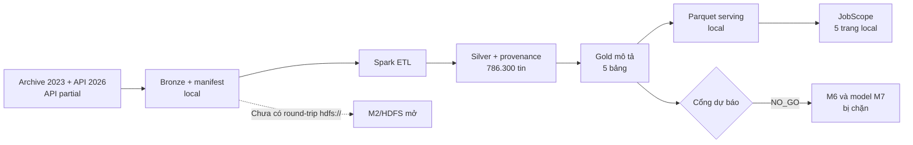

# Báo cáo tiến độ dự án BigData IT Job Skill Analytics

**Cập nhật:** 14/10/2026 · **Nhánh:** `main` · **Phạm vi:** thị trường tuyển dụng CNTT quốc tế; thị trường Việt Nam đang đóng băng trong MVP.

> **Kết luận hiện tại:** Pipeline Bronze → Spark Silver → Gold mô tả và dashboard JobScope đã được kiểm chứng **trên máy cục bộ**. Có **786.300 tin Silver**, **5 bảng Gold mô tả** và dashboard đọc Gold Parquet. Cổng dự báo là **`NO_GO`** vì dữ liệu chưa đủ liên tục và chưa có future test phù hợp. **M2/HDFS, đánh giá taxonomy độc lập, MongoDB và nghiệm thu tích hợp còn mở.** Hồ sơ M7 theo nhánh NO-GO đã sẵn sàng để xét nghiệm thu, **chưa được chấp thuận**.

Báo cáo này tổng hợp run dữ liệu ngày 04/10, kiểm thử gần nhất ngày 13/10 và trạng thái tài liệu được đối chiếu ngày 14/10. Không có run ETL hay nghiệm thu mới được suy ra chỉ từ ngày cập nhật README. Các trạng thái dưới đây là **bằng chứng triển khai**, không phải phần trăm hoàn thành.

## 1. Mục tiêu và phạm vi đã triển khai

Dự án thu thập tin tuyển dụng lịch sử và mới, chuẩn hóa qua Spark, phân tích nhu cầu kỹ năng theo **nguồn × nhóm nghề × kỹ năng × tháng**, rồi trình bày trên dashboard. Phạm vi MVP gồm 8 nhóm nghề CNTT. Phần dự báo Growing/Stable/Declining chỉ được mở khi dữ liệu vượt các cổng trong [Final Plan](FINAL_PLAN_BigData_IT_Job_Market_Skill_Forecasting.md); hiện chưa đủ điều kiện.



## 2. Kết quả có bằng chứng

| Hạng mục | Kết quả gần nhất | Phạm vi và nguồn kiểm chứng |
|---|---:|---|
| Archive lịch sử | **785.741** dòng | Chỉ năm 2023; toàn bộ file local, không đại diện toàn thị trường. |
| Snapshot API mới | **666** dòng | Arbeitnow 650, Remotive 16; run `partial/scoped`. |
| ETL Spark local | **786.407 input → 786.300 Silver** | 1 dòng vào quarantine, 106 bản trùng source identity được gộp; provenance **786.300**, ghép 1:1. |
| Silver theo nguồn | **785.639** archive, **645** Arbeitnow, **16** Remotive | Số sau làm sạch và khử trùng lặp, khác số input Bronze. |
| Gold mô tả | **5 bảng** | `market_stats` 15; `occupation_stats` 127; `skill_evidence_stats` 234; `skill_stats` 4.538; `skill_trends` 4.538 dòng. |
| Dashboard JobScope | **5 trang chạy local** | Tổng quan, Nhóm nghề, Kỹ năng & xu hướng, So sánh nghề, Dự báo & bằng chứng; đọc Gold Parquet có kiểm tra manifest/hash. |

Run Gold được khóa trong [audit Phase 03](docs/data/phase03_analytics_audit.json): `20261004T110131548191Z-e38fa7303cf4`. Báo cáo chi tiết có [số dòng, checksum và công thức phân tích](docs/reviews/PHASE_03_ANALYTICS_REPORT.md). Dashboard không trộn `source_tags` của archive với kỹ năng `extracted_from_jd` của API, giữ tháng thiếu thành khoảng trống và hiển thị `NO_GO / Insufficient evidence`.

## 3. Trạng thái milestone theo Final Plan

| Mốc | Trạng thái ngày 14/10 | Còn cần để đóng mốc |
|---|---|---|
| **M2 — Global Data Ingestion** | **MỞ**. Bronze/ETL local có manifest; chưa có round-trip `hdfs://` → Spark. | Chạy HDFS thật, đối chiếu số dòng và lưu evidence. |
| **M3 — Clean Normalized Dataset** | Silver/provenance **đã kiểm chứng local**. | Chốt biên bản nghiệm thu dataset và liên hệ với M2. |
| **M4 — Occupation–Skill Dataset** | **MỞ**. Taxonomy `v0.1` đã dùng trong ETL/Gold. | Đánh giá title và skill extraction trên tập gán nhãn độc lập theo nguồn/nghề. |
| **M5 — Analytics Layer** | 5 bảng Gold mô tả **đã kiểm chứng local**. | Rà soát phạm vi nguồn, taxonomy và chốt nghiệm thu phân tích. |
| **M6 — ML Dataset** | **BỊ CHẶN** bởi cổng dự báo `NO_GO`. | Chỉ tạo feature/label tương lai khi gate được xét lại thành `GO`. |
| **M7 — Forecast hoặc NO-GO có bằng chứng** | [Hồ sơ nhánh NO-GO](docs/reviews/M7_NO_GO_ACCEPTANCE.md) **sẵn sàng để xét, chưa được nghiệm thu**. Nhánh model vẫn bị chặn. | Nhóm/giảng viên ghi quyết định nghiệm thu hồ sơ; không công bố dự báo. |
| **M8 — Serving Layer** | Parquet serving **chạy local**. | MongoDB nếu tiêu chí môn học yêu cầu; kiểm thử và nghiệm thu tích hợp. |
| **M9 — Working Demo** | JobScope **chạy local**, có kiểm thử giao diện. | Demo end-to-end và nghiệm thu tích hợp với nhóm/giảng viên. |
| **M10 — Final Project** | **CHƯA HOÀN TẤT**. | Tổng hợp biên bản, giới hạn, báo cáo cuối và demo bàn giao. |

### Cổng dự báo

Từ 2023-01 đến 2026-10 có **32 tháng không quan sát**, gồm cả năm 2024–2025 và 2026-01 đến 2026-08. Có **19 ô nghề–tháng dưới 30 tin**. **8 chuỗi source–occupation** của archive đạt ngưỡng số lượng cơ bản trong 12 tháng năm 2023, nhưng điều đó **không** chứng minh nguồn/cách đo tương đương, nhãn kỹ năng đủ chắc hoặc future test đại diện. Fresh API chỉ là snapshot có phạm vi giới hạn. Vì vậy chưa tạo feature `t+1`, chưa train A/B/C/D, chưa có metric mô hình và chưa có dự báo hợp lệ. Xem [dossier M7 dạng JSON](docs/data/m7_no_go_dossier.json) và [quyết định GO/NO-GO](docs/planning/go_no_go_report.md).

## 4. Kiểm thử và giới hạn

| Lần chạy gần nhất (13/10/2026) | Kết quả |
|---|---|
| Pipeline/Spark: `python -m pytest -q tests --ignore=tests/test_dashboard.py` | **26 passed, 1 skipped**; skip là kiểm thử HDFS live chưa có URI/dịch vụ. Có 3 cảnh báo môi trường PySpark/Pandas/Arrow. |
| Dashboard: `.venv-dashboard/Scripts/python.exe -m pytest -q tests/test_dashboard.py` | **13 passed**. |
| Tổng hai môi trường | **39 test đạt, 1 test HDFS live chưa chạy**. 11 test dossier M7 đã nằm trong 26 test pipeline, không cộng thêm lần nữa. |

Log kiểm thử được lưu local trong `tmp/m7_pipeline_regression.log` và `tmp/m7_dashboard_regression.log` (không đưa vào Git). Đây là kết quả ngày 13/10; báo cáo ngày 14/10 không hàm ý đã chạy lại toàn bộ suite.

Các hạn chế ảnh hưởng trực tiếp đến kết luận:

- Archive chỉ có năm 2023 và không có mô tả công việc gốc; snapshot API 2026 nhỏ, `partial/scoped`, không có tháng giao nhau với archive. Khoảng trống thời gian là **thiếu quan sát**, không phải nhu cầu bằng 0.
- `source_tags` và `extracted_from_jd` là hai cách đo khác nhau; chưa hiệu chỉnh source mix. Tỷ lệ `Other IT` cao ở API cần đánh giá taxonomy bằng nhãn độc lập.
- Quyền sử dụng/điều khoản và provenance nguồn cần xác minh trước khi công bố dữ liệu hay khẳng định đại diện thị trường.
- `PHASE02_HDFS_URI` chưa được cấu hình tại lần preflight 13/10; không có bằng chứng HDFS end-to-end. Dashboard local và Parquet serving chưa đồng nghĩa với nghiệm thu M8/M9.

## 5. Việc cần làm tiếp theo

1. **M2/HDFS:** dựng hoặc kết nối HDFS, chạy [smoke test theo runbook Phase 02](docs/planning/phase02_runbook.md) với Bronze run được chọn; xác minh URI `hdfs://`, manifest Bronze, số dòng Spark đọc từ HDFS và số dòng Parquet HDFS đọc lại khớp nhau. Lưu evidence và đối chiếu thêm tiêu chí M2 trong Final Plan trước khi nghiệm thu.
2. **Nguồn và M4:** lập bảng URL, phiên bản, ngày tải, checksum, license/điều khoản; gán nhãn độc lập một mẫu title/JD theo từng nguồn/nghề, báo precision/recall/F1 và coverage.
3. **M3/M5/M7:** đưa Silver/Gold audit cùng [hồ sơ NO-GO M7](docs/reviews/M7_NO_GO_ACCEPTANCE.md) ra review chính thức; ghi rõ chấp thuận hoặc yêu cầu sửa trong biên bản.
4. **M8/M9:** kiểm thử một đường dữ liệu từ Gold đến giao diện; chốt yêu cầu MongoDB với tiêu chí môn học, rồi nghiệm thu demo JobScope và các trạng thái dữ liệu rỗng/gap/`NO_GO`.
5. **Dữ liệu và M10:** thu thập thêm tháng còn thiếu, kiểm tra lại gate trước bất kỳ feature/model nào; tổng hợp báo cáo cuối, giới hạn nghiên cứu và kịch bản demo.

## 6. Xem dashboard và tài liệu

Chạy từ thư mục repository trên máy có Gold Parquet của run đã khóa:

```powershell
python -m venv .venv-dashboard
./.venv-dashboard/Scripts/python.exe -m pip install -r requirements-dashboard.txt
./run_dashboard.ps1
```

Mở <http://127.0.0.1:8501>. Những lần sau chỉ cần `./run_dashboard.ps1`. Clone mới chưa có Gold Parquet local sẽ nhận hướng dẫn khôi phục, không tự chọn run khác. Xem [runbook dashboard](docs/planning/dashboard_runbook.md).

| Tài liệu | Mục đích |
|---|---|
| [Final Plan](FINAL_PLAN_BigData_IT_Job_Market_Skill_Forecasting.md) | Phạm vi, tiêu chí milestone và cổng dự báo. |
| [Báo cáo Phase 03](docs/reviews/PHASE_03_ANALYTICS_REPORT.md) | Run ETL/Gold, thống kê và checksum chi tiết. |
| [Audit Phase 03](docs/data/phase03_analytics_audit.json) | Bằng chứng máy đọc được cho Gold và gate. |
| [Hồ sơ M7 NO-GO](docs/reviews/M7_NO_GO_ACCEPTANCE.md) | Đề xuất xét nghiệm thu nhánh không dự báo. |
| [Tiến độ ngày 12/10, bổ sung 13/10](docs/planning/PROJECT_PROGRESS_2026-10-12.md) | Snapshot lịch sử và các bước tại thời điểm đó. |
