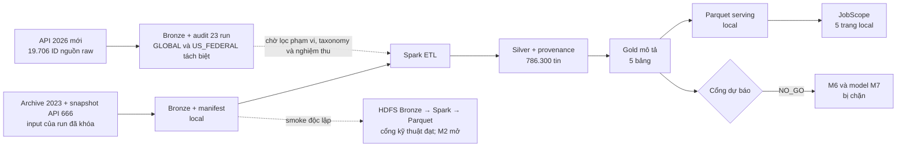

# Báo cáo tiến độ dự án BigData IT Job Skill Analytics

**Cập nhật:** 15/10/2026 · **Nhánh:** `main` · **Phạm vi:** thị trường tuyển dụng CNTT quốc tế; thị trường Việt Nam đang đóng băng trong MVP.

> **Kết luận hiện tại:** Pipeline Bronze → Spark Silver → Gold mô tả và dashboard JobScope đã được kiểm chứng **trên máy cục bộ**. Run đã khóa có **786.300 tin Silver**, **5 bảng Gold mô tả** và dashboard đọc Gold Parquet. Đợt thu Bronze 2026 mới được audit **19.706 ID nguồn duy nhất**, nhưng chưa qua cổng chất lượng để thay Silver/Gold. **Cổng kỹ thuật HDFS → Spark đã đạt** trên Docker; **M2 vẫn mở để chốt điều kiện vận hành/nghiệm thu**. Dự báo vẫn **`NO_GO`**; đánh giá taxonomy độc lập, MongoDB và nghiệm thu tích hợp còn mở. Hồ sơ M7 nhánh NO-GO sẵn sàng để xét, **chưa được chấp thuận**.

Báo cáo này tổng hợp run ETL/Gold ngày 04/10, smoke HDFS và đợt thu Bronze 2026 ngày 15/10 theo giờ Việt Nam. Đợt thu mới **chưa** tạo run ETL/Gold hay nghiệm thu chính thức. Các trạng thái dưới đây là **bằng chứng triển khai**, không phải phần trăm hoàn thành.

## 1. Mục tiêu và phạm vi đã triển khai

Dự án thu thập tin tuyển dụng lịch sử và mới, chuẩn hóa qua Spark, phân tích nhu cầu kỹ năng theo **nguồn × nhóm nghề × kỹ năng × tháng**, rồi trình bày trên dashboard. Phạm vi MVP gồm 8 nhóm nghề CNTT. Phần dự báo Growing/Stable/Declining chỉ được mở khi dữ liệu vượt các cổng trong [Final Plan](FINAL_PLAN_BigData_IT_Job_Market_Skill_Forecasting.md); hiện chưa đủ điều kiện.



## 2. Kết quả có bằng chứng

| Hạng mục | Kết quả gần nhất | Phạm vi và nguồn kiểm chứng |
|---|---:|---|
| Archive lịch sử | **785.741** dòng | Chỉ năm 2023; toàn bộ file local, không đại diện toàn thị trường. |
| Snapshot API dùng cho Silver/Gold hiện tại | **666** dòng | Arbeitnow 650, Remotive 16; run `partial/scoped` ngày 04/10. |
| ETL Spark local | **786.407 input → 786.300 Silver** | 1 dòng vào quarantine, 106 bản trùng source identity được gộp; provenance **786.300**, ghép 1:1. |
| Silver theo nguồn | **785.639** archive, **645** Arbeitnow, **16** Remotive | Số sau làm sạch và khử trùng lặp, khác số input Bronze. |
| Gold mô tả | **5 bảng** | `market_stats` 15; `occupation_stats` 127; `skill_evidence_stats` 234; `skill_stats` 4.538; `skill_trends` 4.538 dòng. |
| Dashboard JobScope | **5 trang chạy local** | Tổng quan, Nhóm nghề, Kỹ năng & xu hướng, So sánh nghề, Dự báo & bằng chứng; đọc Gold Parquet có kiểm tra manifest/hash. |

Run Gold được khóa trong [audit Phase 03](docs/data/phase03_analytics_audit.json): `20261004T110131548191Z-e38fa7303cf4`. Báo cáo chi tiết có [số dòng, checksum và công thức phân tích](docs/reviews/PHASE_03_ANALYTICS_REPORT.md). Dashboard không trộn `source_tags` của archive với kỹ năng `extracted_from_jd` của API, giữ tháng thiếu thành khoảng trống và hiển thị `NO_GO / Insufficient evidence`.

**Đợt bổ sung 2026 (Bronze, chưa vào dashboard):** [audit ngày 15/10](docs/data/2026_ingestion_audit.json) xác minh **19.706** ID nguồn duy nhất: Arbeitnow **12.952** và Remotive **15** thuộc snapshot `GLOBAL`, USAJOBS Historic series 2210 **6.739** thuộc riêng `US_FEDERAL` với 21 khoảng ngày liên tiếp từ 01/01 đến 15/10. **91,7%** tiêu đề chưa khớp 8 nhóm nghề trong taxonomy `v0.1`; không diễn giải tập raw này là nhu cầu IT đã xác nhận hay đổi trạng thái dự báo. Mã thu và audit đã qua review C2C; **14 test collector/identity đạt**. Xem [báo cáo bổ sung dữ liệu 2026](docs/reviews/2026_DATA_EXPANSION_2026-10-15.md) để biết phạm vi, giới hạn và kiểm thử. Raw Bronze chỉ lưu local, không nằm trong bản clone GitHub.

## 3. Trạng thái milestone theo Final Plan

| Mốc | Trạng thái ngày 15/10 | Còn cần để đóng mốc |
|---|---|---|
| **M2 — Global Data Ingestion** | **MỞ/CONDITIONAL**. [Cổng kỹ thuật HDFS → Spark đã đạt](docs/reviews/M2_HDFS_REVIEW_2026-10-15.md): historical 785.741 và fresh 666 dòng đọc/ghi HDFS khớp. Collector mới đã thu Bronze 2026 có audit, nhưng mới một kỳ snapshot. | Chốt đường HDFS → ETL → Silver, thu fresh định kỳ/kiểm tra ổn định nguồn, xử lý replica và nghiệm thu toàn mốc. |
| **M3 — Clean Normalized Dataset** | Silver/provenance **đã kiểm chứng local**. | Chốt biên bản nghiệm thu dataset và liên hệ với M2. |
| **M4 — Occupation–Skill Dataset** | **MỞ**. Taxonomy `v0.1` đã dùng trong ETL/Gold; 91,7% title trong Bronze mới chưa khớp 8 nghề. | Lọc phạm vi IT và đánh giá title/skill extraction trên tập gán nhãn độc lập theo nguồn/nghề. |
| **M5 — Analytics Layer** | 5 bảng Gold mô tả **đã kiểm chứng local**. | Rà soát phạm vi nguồn, taxonomy và chốt nghiệm thu phân tích. |
| **M6 — ML Dataset** | **BỊ CHẶN** bởi cổng dự báo `NO_GO`. | Chỉ tạo feature/label tương lai khi gate được xét lại thành `GO`. |
| **M7 — Forecast hoặc NO-GO có bằng chứng** | [Hồ sơ nhánh NO-GO](docs/reviews/M7_NO_GO_ACCEPTANCE.md) **sẵn sàng để xét, chưa được nghiệm thu**. Nhánh model vẫn bị chặn. | Nhóm/giảng viên ghi quyết định nghiệm thu hồ sơ; không công bố dự báo. |
| **M8 — Serving Layer** | Parquet serving **chạy local**. | MongoDB nếu tiêu chí môn học yêu cầu; kiểm thử và nghiệm thu tích hợp. |
| **M9 — Working Demo** | JobScope **chạy local**, có kiểm thử giao diện. | Demo end-to-end và nghiệm thu tích hợp với nhóm/giảng viên. |
| **M10 — Final Project** | **CHƯA HOÀN TẤT**. | Tổng hợp biên bản, giới hạn, báo cáo cuối và demo bàn giao. |

### Cổng dự báo

Trong Gold hiện đang khóa, từ 2023-01 đến 2026-10 có **32 tháng không quan sát**, gồm cả năm 2024–2025 và 2026-01 đến 2026-08. Có **19 ô nghề–tháng dưới 30 tin**. **8 chuỗi source–occupation** của archive đạt ngưỡng số lượng cơ bản trong 12 tháng năm 2023, nhưng điều đó **không** chứng minh nguồn/cách đo tương đương, nhãn kỹ năng đủ chắc hoặc future test đại diện. Fresh API trong Gold chỉ là snapshot có phạm vi giới hạn; Bronze 2026 mới cũng chưa vượt cổng chất lượng và so sánh nguồn. Vì vậy chưa tạo feature `t+1`, chưa train A/B/C/D, chưa có metric mô hình và chưa có dự báo hợp lệ. Xem [dossier M7 dạng JSON](docs/data/m7_no_go_dossier.json) và [quyết định GO/NO-GO](docs/planning/go_no_go_report.md).

## 4. Kiểm thử và giới hạn

| Lần chạy | Kết quả |
|---|---|
| Pipeline/Spark trong Docker, 15/10: `python -m pytest -q tests --ignore=tests/test_dashboard.py` | **27 passed, 0 skipped**; HDFS live test đã chạy. Có 1 cảnh báo Arrow fallback. |
| HDFS live riêng trong Docker, 15/10: `python -m pytest -q tests/test_phase02_hdfs.py` | **2 passed, 0 skipped**; hai test này đã nằm trong 27 test pipeline. |
| Dashboard trong môi trường UI, lần gần nhất 13/10 | **13 passed**; không chạy lại trong review M2 vì không đổi code UI. |
| Collector/audit 2026 trên host, 15/10: `python -m pytest -q tests/test_2026_collectors.py tests/test_phase02_ingestion.py tests/test_phase02_identity.py` | **14 passed**; audit 23 run kiểm tra hash, ID/ngày và 21 khoảng USAJOBS liên tiếp. |

Log kiểm thử M2 mới lưu local trong `tmp/m2_hdfs_live_test_2026-10-15.log` và `tmp/m2_pipeline_regression_2026-10-15.log` (không đưa vào Git). Xem [review M2](docs/reviews/M2_HDFS_REVIEW_2026-10-15.md) để đối chiếu evidence; kết quả dashboard vẫn là lần chạy 13/10.

Các hạn chế ảnh hưởng trực tiếp đến kết luận:

- Archive chỉ có năm 2023 và không có mô tả công việc gốc; snapshot API đang dùng trong Gold nhỏ, `partial/scoped`, không có tháng giao nhau với archive. Bronze 2026 mới chưa qua cổng chất lượng Silver/Gold và nguồn liên bang Mỹ có phạm vi riêng. Khoảng trống thời gian là **thiếu quan sát**, không phải nhu cầu bằng 0.
- `source_tags` và `extracted_from_jd` là hai cách đo khác nhau; chưa hiệu chỉnh source mix. Tỷ lệ `Other IT` cao ở API cần đánh giá taxonomy bằng nhãn độc lập.
- Quyền sử dụng/điều khoản và provenance nguồn cần xác minh trước khi công bố dữ liệu hay khẳng định đại diện thị trường.
- HDFS smoke hiện kiểm tra Bronze → Spark → Parquet trên HDFS, **chưa chứng minh ETL Silver đọc Bronze từ HDFS**. Cluster Docker chỉ có một DataNode, các block smoke đang under-replicated; chưa có bằng chứng vận hành chịu lỗi. Dashboard local và Parquet serving chưa đồng nghĩa với nghiệm thu M8/M9.

## 5. Việc cần làm tiếp theo

1. **M2/HDFS:** dùng [evidence HDFS đã đạt](docs/reviews/M2_HDFS_REVIEW_2026-10-15.md) để chạy tiếp đường HDFS → Spark ETL → Silver/provenance hoặc chốt phạm vi nghiệm thu với nhóm; bổ sung lịch thu fresh, kiểm tra nguồn qua nhiều kỳ và xử lý under-replicated block trước khi đề xuất đóng toàn mốc.
2. **Nguồn và M4:** dùng [audit 2026](docs/data/2026_ingestion_audit.json) để lấy mẫu gán nhãn độc lập theo nguồn, nhất là `Other IT`; lọc tin ngoài phạm vi, báo precision/recall/F1 và coverage trước khi tạo Silver/Gold mới. Thu snapshot fresh theo nhiều kỳ; giữ `US_FEDERAL` riêng.
3. **M3/M5/M7:** đưa Silver/Gold audit cùng [hồ sơ NO-GO M7](docs/reviews/M7_NO_GO_ACCEPTANCE.md) ra review chính thức; ghi rõ chấp thuận hoặc yêu cầu sửa trong biên bản.
4. **M8/M9:** kiểm thử một đường dữ liệu từ Gold đến giao diện; chốt yêu cầu MongoDB với tiêu chí môn học, rồi nghiệm thu demo JobScope và các trạng thái dữ liệu rỗng/gap/`NO_GO`.
5. **Dữ liệu và M10:** thu thập thêm tháng còn thiếu, kiểm tra lại gate trước bất kỳ feature/model nào; tổng hợp báo cáo cuối, giới hạn nghiên cứu và kịch bản demo.

## 6. Xem dashboard và tài liệu

Chạy từ thư mục repository trên máy có Gold Parquet của run đã khóa:

```powershell
python -m venv .venv-dashboard
./.venv-dashboard/Scripts/python.exe -m pip install -r requirements-dashboard.txt
./run_dashboard.ps1
```

Mở <http://127.0.0.1:8501>. Những lần sau chỉ cần `./run_dashboard.ps1`. Clone mới chưa có Gold Parquet local sẽ nhận hướng dẫn khôi phục, không tự chọn run khác. Xem [runbook dashboard](docs/planning/dashboard_runbook.md).

| Tài liệu | Mục đích |
|---|---|
| [Final Plan](FINAL_PLAN_BigData_IT_Job_Market_Skill_Forecasting.md) | Phạm vi, tiêu chí milestone và cổng dự báo. |
| [Báo cáo Phase 03](docs/reviews/PHASE_03_ANALYTICS_REPORT.md) | Run ETL/Gold, thống kê và checksum chi tiết. |
| [Audit Phase 03](docs/data/phase03_analytics_audit.json) | Bằng chứng máy đọc được cho Gold và gate. |
| [Hồ sơ M7 NO-GO](docs/reviews/M7_NO_GO_ACCEPTANCE.md) | Đề xuất xét nghiệm thu nhánh không dự báo. |
| [Review M2 HDFS ngày 15/10](docs/reviews/M2_HDFS_REVIEW_2026-10-15.md) | Bằng chứng HDFS, ma trận P2-01…P2-11 và điều kiện đóng M2. |
| [Bổ sung dữ liệu 2026](docs/reviews/2026_DATA_EXPANSION_2026-10-15.md) | 19.706 ID nguồn, độ phủ, giới hạn taxonomy và kiểm thử collector. |
| [Sơ đồ tiến độ 15/10](docs/planning/PROJECT_PROGRESS_DIAGRAM_2026-10-15.md) | Các mốc đã có bằng chứng, nhánh còn mở và phần đang bị chặn. |
| [Tiến độ ngày 12/10, bổ sung 13/10](docs/planning/PROJECT_PROGRESS_2026-10-12.md) | Snapshot lịch sử và các bước tại thời điểm đó. |
