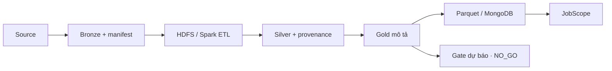

# Nội dung trình bày dự án (10 slide)

Tài liệu này là bản nội dung của [trình chiếu PowerPoint 10 slide](BigData_Job_Analy_Final_2026-10-15_v2.pptx). Số liệu khóa theo audit ngày 15/10/2026; không cập nhật bằng số mới nếu chưa tái chạy audit.

---

## 1. Tên và câu hỏi nghiên cứu

**BigData Job Analy — IT jobs, skills and observed trends**. Trong các nguồn tuyển dụng đã thu, nghề và kỹ năng nào xuất hiện theo tháng? Khi nào có đủ bằng chứng để dự báo?

## 2. Phạm vi

- MVP quốc tế, tám nhóm nghề IT; Việt Nam đóng băng.
- Archive 2023, snapshot Arbeitnow/Remotive 2026, và USAJOBS liên bang Mỹ trong Bronze riêng.
- Kết luận chỉ cho mẫu thu thập; không suy rộng toàn thị trường.

## 3. Kiến trúc

## 4. Chất lượng dữ liệu

- 786.407 input của run chính → 786.300 Silver; 1 quarantine, 106 trùng identity.
- 19.706 ID Bronze 2026 mới, nhưng 91,7% title chưa khớp tám nghề.
- `GLOBAL` và `US_FEDERAL` tách biệt; snapshot API không tạo lịch sử giả.

## 5. HDFS và xử lý lớn

- Run tích hợp fresh: HDFS Bronze 666 → Spark ETL → 661 Silver/provenance.
- Manifest/hash, số dòng và FSCK có evidence; lab một DataNode, replica 1 cho run.
- Run Gold chính có 786.300 Silver local; HDFS test là đường riêng.

## 6. Gold và phép đo

- 5 bảng: market, occupation, skill evidence, skill stats, skill trends.
- Tỷ lệ kỹ năng có mẫu số nghề gồm cả tin thiếu kỹ năng; `source_tags` và `extracted_from_jd` tách riêng.
- Tháng thiếu để trống, không đổi thành 0.

## 7. Serving và dashboard

- Parquet và MongoDB đọc cùng Gold run đã khóa bằng audit/hash.
- JobScope 6 trang, gồm kiểm kê Bronze 2026 và trang bằng chứng forecast.
- Live demo: tổng quan → kỹ năng → so sánh → Bronze 2026 → `NO_GO`.

## 8. Gate dự báo

- Gold run có 32 tháng thiếu giữa 2023-01 và 2026-10; 19 ô nghề–tháng dưới 30 tin.
- Nguồn/cách đo chưa hiệu chỉnh và taxonomy chưa được kiểm định độc lập.
- Quyết định: **`NO_GO`**, không huấn luyện/publish nhãn Growing/Stable/Declining.

## 9. Kiểm thử

- Pipeline Spark/HDFS: **37 passed**; Dashboard/serving: **14 passed**.
- HDFS→ETL và MongoDB readback chạy thật; dashboard Mongo health 200.
- Test kỹ thuật không thay nhãn thủ công và nghiệm thu học thuật.

## 10. Kết luận và bước tiếp

- Sản phẩm phân tích mô tả và demo có thể chạy local; hồ sơ `NO_GO` bảo vệ kết luận dự báo.
- Gán nhãn 95 JD, thu snapshot nhiều kỳ, ký nghiệm thu mốc và trình bày chính thức.
- Chỉ xét lại forecast sau khi cổng dữ liệu và rolling-origin future test đạt.
