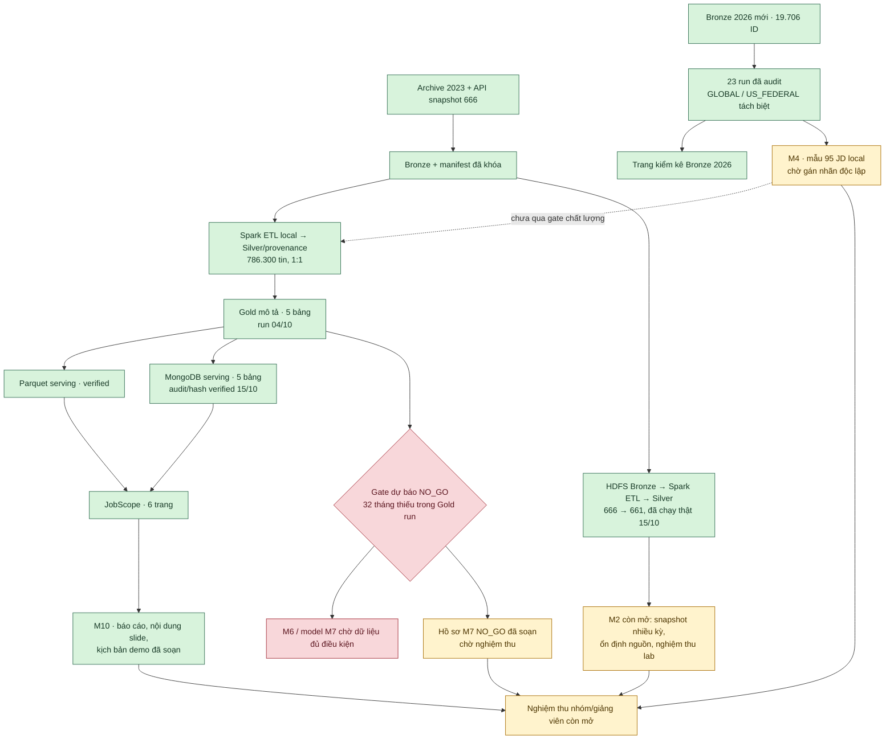

# Sơ đồ tiến độ dự án — cập nhật 15/10/2026

Trạng thái dựa trên bằng chứng chạy thật và giới hạn nghiệm thu, không quy đổi thành phần trăm. Nhánh Gold hiện hành dùng archive 2023 và snapshot API 666 dòng; đợt Bronze 2026 mới được trình bày riêng.

M3/M5 có output local được kiểm chứng, M8 có cả Parquet và MongoDB, M9 có giao diện chạy và test. M2/M3/M4/M5/M7/M8/M9/M10 vẫn cần các quyết định nghiệm thu nêu trong [README](../../README.md) và [báo cáo cuối](../final/FINAL_REPORT_2026-10-15.md). Đường HDFS→Silver là run kiểm thử fresh 666 dòng, không thay Gold 786.300 tin. Bản ghi Bronze 2026 không được coi là nhu cầu IT đã xác nhận; forecast giữ `NO_GO`.
