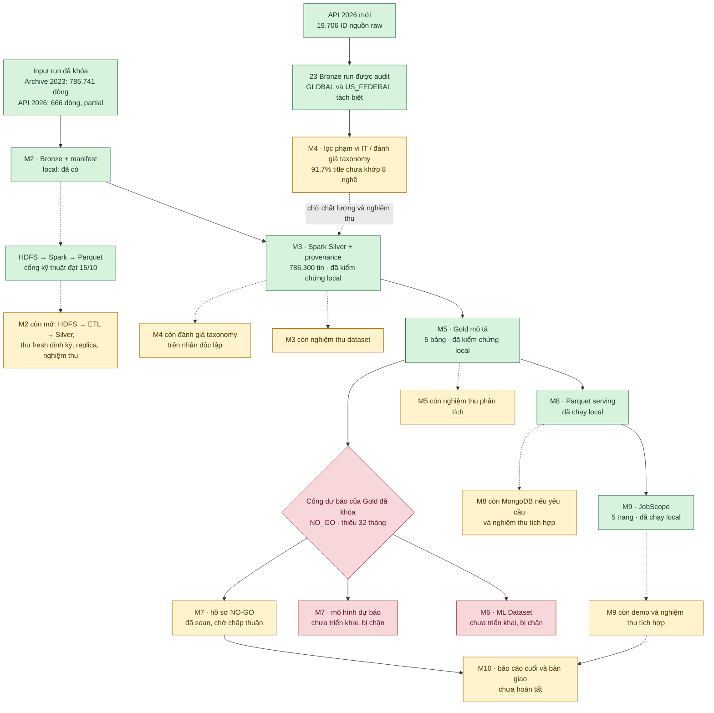

# Sơ đồ tiến độ dự án — 15/10/2026

Sơ đồ này ghi **trạng thái theo bằng chứng**, không quy đổi thành phần trăm hoàn thành. Silver/Gold và dashboard là run local đã khóa ngày 04/10; HDFS là smoke live ngày 15/10. Đợt dữ liệu 2026 mới đã vào Bronze/audit ngày 15/10 nhưng chưa vào Silver/Gold.

**Chú giải:** xanh = có bằng chứng triển khai local/kỹ thuật; vàng = còn việc hoặc nghiệm thu; đỏ = cổng dự báo `NO_GO`, nhánh model bị chặn. M2 HDFS technical gate đạt **không** đồng nghĩa M2 được nghiệm thu. 19.706 bản ghi Bronze mới **không phải** 19.706 tin IT đã xác nhận; dashboard vẫn đọc Gold cũ và chưa công bố dự báo.

**Nguồn đối chiếu:** [báo cáo tiến độ](../../README.md), [audit Bronze 2026](../data/2026_ingestion_audit.json), [báo cáo dữ liệu 2026](../reviews/2026_DATA_EXPANSION_2026-10-15.md), [review M2 HDFS](../reviews/M2_HDFS_REVIEW_2026-10-15.md), [báo cáo Phase 03](../reviews/PHASE_03_ANALYTICS_REPORT.md), [hồ sơ M7 NO-GO](../reviews/M7_NO_GO_ACCEPTANCE.md), [Final Plan](../../FINAL_PLAN_BigData_IT_Job_Market_Skill_Forecasting.md).
