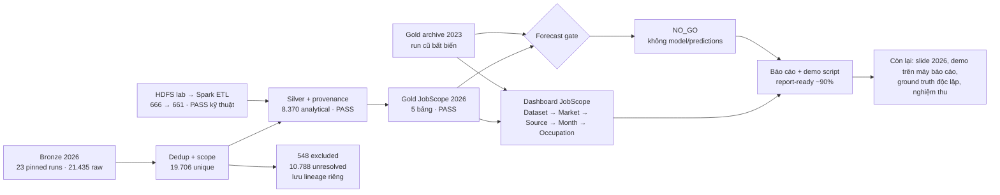

# Sơ đồ tiến độ BigData Job Analy · 15/10/2026

Tiến độ khoảng **90% theo hạng mục bàn giao**: đường dữ liệu mô tả 2026 đã hoàn tất và audit đạt; nhánh dự báo có quyết định `NO_GO` có căn cứ. Phần còn lại là đánh giá độc lập, chuẩn bị máy demo, cập nhật slide và nghiệm thu. Phần trăm này không đo độ đúng của taxonomy hoặc khả năng dự báo.

## Trạng thái từng nhánh

| Nhánh | Trạng thái | Bằng chứng và việc tiếp theo |
| --- | --- | --- |
| Bronze 2026 | Đạt | [Audit 23 run](../data/2026_ingestion_audit.json); tiếp tục thu nhiều kỳ nếu nghiên cứu xu hướng. |
| Silver 2026 | Đạt | [Audit](../data/2026_silver_run_audit.json); giữ riêng excluded và unresolved. |
| Taxonomy/scope | Đạt cho descriptive v1; cần đánh giá độc lập | [AI review](../reviews/2026_IT_SCOPE_AI_REVIEW_2026-10-15.md) không phải ground truth. |
| Gold 2026 | Đạt | [Audit](../data/2026_gold_run_audit.json); market-safe, 8.370 tin. |
| Dashboard 2026 | Đạt trên máy local | Hai dataset audit pin; kiểm tra lại trên máy trình bày. |
| HDFS M2 | Đạt đường tích hợp, nghiệm thu lab còn mở | [Audit HDFS→ETL](../data/m2_hdfs_etl_audit.json); một DataNode không chịu lỗi node. |
| Dự báo M6/M7 | `NO_GO` có bằng chứng | Cần phê duyệt nhánh `NO_GO`; không có dự báo để demo. |
| Slide, demo, nghiệm thu M10 | Đang hoàn thiện | [Outline](../final/PRESENTATION_OUTLINE_2026-10-15.md), [demo script](../final/DEMO_SCRIPT.md), biên bản chấp thuận. |

`GLOBAL` 2026 chỉ gồm Arbeitnow 1.621 và Remotive 10 tin đủ bằng chứng theo policy; `US_FEDERAL` gồm 6.739 USAJOBS series 2210. Không trộn mẫu số, không zero-fill tháng thiếu, không suy ra 10.788 unresolved là non-IT.
