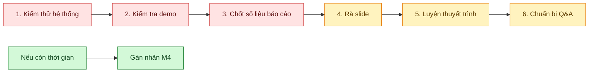
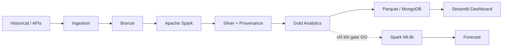

# Checklist hôm nay để báo cáo ngày mai

> **Dự án:** BigData IT Job Skill Analytics  
> **Ngày chuẩn bị:** 15/10/2026  
> **Mục tiêu:** chốt hệ thống, bằng chứng kỹ thuật, slide và kịch bản demo để báo cáo ngày mai.  
> **Nguyên tắc:** hôm nay ưu tiên **ổn định + kiểm chứng + luyện báo cáo**, không mở thêm chức năng lớn.

---

## 1. Mục tiêu cuối ngày

Đến cuối hôm nay cần đạt được 5 việc:

- [ ] Pipeline chính chạy ổn định và có log/test làm bằng chứng.
- [ ] Dashboard mở được, các trang chính không lỗi.
- [ ] Slide dùng đúng số liệu hiện hành, không trộn run cũ.
- [ ] Có kịch bản demo cố định theo luồng kiến trúc.
- [ ] Có thể trả lời các câu hỏi phản biện về Spark, Bronze/Silver/Gold và GO/NO_GO.

---

## 2. Sơ đồ ưu tiên hôm nay

---

# 3. P0 — Bắt buộc hoàn thành trước khi nghỉ

## 3.1 Chạy lại test và lưu bằng chứng

### Pipeline / Spark / HDFS

- [ ] Chạy test pipeline hiện hành.
- [ ] Xác nhận không có test fail.
- [ ] Lưu terminal output hoặc chụp màn hình.
- [ ] Kiểm tra HDFS→Spark ETL evidence nếu sẽ trình bày phần HDFS.

**Bằng chứng gần nhất trong repo:**
- Pipeline Spark/HDFS: **37 passed**.
- Dashboard/MongoDB: **14 passed**.
- HDFS fresh run: **666 input → 661 Silver + 661 provenance**.
- HDFS FSCK của run audit: **HEALTHY**.

> Khi báo cáo, nói rõ: test chứng minh luồng kỹ thuật; **không** chứng minh taxonomy chính xác hoặc dữ liệu đại diện toàn thị trường.

---

## 3.2 Kiểm tra dashboard trước buổi báo cáo

- [ ] Mở Dashboard bằng Parquet.
- [ ] Nếu demo MongoDB: publish/readback Gold và mở dashboard backend Mongo.
- [ ] Kiểm tra đủ **6 trang**.
- [ ] Thử filter occupation / skill / time.
- [ ] Mở trang **Dự báo & bằng chứng** và xác nhận hiển thị `NO_GO`.
- [ ] Mở trang **Dữ liệu 2026** và xác nhận đây là Bronze inventory riêng.
- [ ] Kiểm tra không có exception trên trang Tổng quan.
- [ ] Kiểm tra HTTP health nếu dùng server local.

### 6 trang nên nhớ

1. Tổng quan.
2. Nhóm nghề.
3. Kỹ năng & xu hướng.
4. So sánh nghề.
5. Dự báo & bằng chứng.
6. Dữ liệu 2026.

---

## 3.3 Chốt bộ số liệu duy nhất dùng ngày mai

> Không trộn các run acceptance cũ với Gold run hiện hành.

| Nội dung | Số liệu nên dùng |
|---|---:|
| Historical Bronze 2023 | **785.741** |
| Fresh Bronze dùng trong Gold | **666** |
| ETL input | **786.407** |
| Silver hiện hành | **786.300** |
| Provenance | **786.300 — 1:1 với Silver** |
| Quarantine | **1** |
| Duplicate identity được gộp | **106** |
| Gold tables | **5 bảng** |
| Bronze 2026 mới | **19.706 source IDs / 23 runs** |
| Dashboard | **6 trang** |
| Khoảng tháng thiếu trong Gold timeline | **32 tháng** |
| Predictive gate | **NO_GO** |

### 5 bảng Gold

- `market_stats`
- `occupation_stats`
- `skill_evidence_stats`
- `skill_stats`
- `skill_trends`

---

# 4. P1 — Chốt nội dung thuyết trình

## 4.1 Học thuộc luồng kiến trúc bằng 1 câu

> **Ingestion đưa dữ liệu vào Bronze; Spark đọc Bronze để làm sạch, chuẩn hóa, dedup và tạo Silver + provenance; Spark tiếp tục aggregate Silver thành Gold; Gold được phục vụ qua Parquet/MongoDB cho Dashboard; nhánh ML chỉ mở khi predictive gate chuyển GO.**

### Sơ đồ cần trình bày

---

## 4.2 Chuẩn bị câu trả lời: Spark làm gì?

Bạn cần trả lời ngắn gọn được các ý sau:

- Đọc dữ liệu Bronze.
- Chuẩn hóa schema từ nhiều nguồn.
- Làm sạch text.
- Parse timestamp.
- Normalize Job Title.
- Normalize / extract skill.
- Tạo stable `job_id`.
- Deduplicate.
- Quarantine record lỗi.
- Ghi Silver dạng Parquet partition.
- Aggregate Silver thành Gold.
- Spark MLlib chỉ sử dụng khi đủ điều kiện dự báo.

### Câu trả lời mẫu

> **Spark là engine xử lý dữ liệu lớn của hệ thống. Nó không phải nơi lưu trữ. Spark biến dữ liệu Bronze gần raw thành Silver sạch/chuẩn hóa, sau đó tổng hợp Silver thành các bảng Gold phục vụ analytics và dashboard.**

---

## 4.3 Chuẩn bị câu trả lời: Bronze / Silver / Gold

| Layer | Ý nghĩa | Trong đồ án |
|---|---|---|
| **Bronze** | Dữ liệu gần raw | Historical + API + metadata + manifest |
| **Silver** | Dữ liệu sạch, thống nhất | 18-field schema, dedup, timestamp, taxonomy |
| **Gold** | Dữ liệu tổng hợp phục vụ sản phẩm | occupation/skill stats, trends, dashboard |

Câu dễ nhớ:

> **Bronze = dữ liệu gốc, Silver = dữ liệu sạch, Gold = dữ liệu dùng để trả lời câu hỏi.**

---

## 4.4 Chuẩn bị GO / CONDITIONAL GO / NO_GO

### Trạng thái nên trình bày

- **GO:** ingestion, pipeline kỹ thuật, Silver, Gold descriptive.
- **CONDITIONAL GO:** descriptive analytics trong đúng phạm vi nguồn đã quan sát.
- **NO_GO:** forecasting / predictive claims.

### Vì sao forecast NO_GO?

- [ ] Archive chỉ có năm 2023.
- [ ] Timeline Gold thiếu **32 tháng**, gồm 2024–2025.
- [ ] Nguồn 2023 và fresh API có phạm vi khác nhau.
- [ ] Historical dùng `source_tags`, fresh dùng skill trích từ JD.
- [ ] Taxonomy chưa có independent labels đủ để báo precision/recall/F1.
- [ ] Chưa có rolling-origin future test hợp lệ.

> **Không nói:** “model bị lỗi”.  
> **Nên nói:** “predictive gate không đạt vì dữ liệu chưa đủ bằng chứng để tạo một phép dự báo đáng tin cậy.”

---

# 5. P1 — Rà lại slide

Slide ngày mai tối thiểu nên có:

- [ ] 1. Bài toán & mục tiêu.
- [ ] 2. Nguồn dữ liệu.
- [ ] 3. Kiến trúc hệ thống.
- [ ] 4. Bronze / Silver / Gold.
- [ ] 5. Vai trò Spark + HDFS.
- [ ] 6. Kết quả Gold analytics.
- [ ] 7. MongoDB / Dashboard.
- [ ] 8. GO / NO_GO.
- [ ] 9. Điểm mạnh & hạn chế.
- [ ] 10. Công việc tiếp theo / kết luận.

### Kiểm tra slide

- [ ] Không ghi forecast Growing/Stable/Declining như kết quả thật.
- [ ] Không có Macro-F1/model score nếu chưa train hợp lệ.
- [ ] Không gọi 2023 + 2026 là chuỗi liên tục.
- [ ] Không gọi số job của nguồn thu thập là toàn thị trường thế giới.
- [ ] Mọi số liệu khớp README / Final Report hiện hành.

---

# 6. P1 — Kịch bản demo 5–7 phút

## Thứ tự đề xuất

### Bước 1 — Giới thiệu dữ liệu
Nói:

> Hệ thống dùng archive historical 2023 và dữ liệu fresh từ API. Dữ liệu được quản lý theo run và manifest để truy vết.

### Bước 2 — Bronze
Chỉ ra:
- dữ liệu gần raw;
- source;
- checksum;
- manifest.

### Bước 3 — Spark → Silver
Nói:
- clean;
- normalize;
- dedup;
- provenance;
- quarantine.

### Bước 4 — Gold
Mở hoặc mô tả 5 bảng Gold.

### Bước 5 — Dashboard
Demo:
- Tổng quan;
- occupation;
- skill trend;
- so sánh;
- NO_GO evidence.

### Bước 6 — Kết luận
Nói:

> Hệ thống đã hoàn thiện pipeline phân tích mô tả end-to-end. Forecasting chưa được mở vì predictive gate không đạt; đây là quyết định dựa trên bằng chứng, không phải lỗi hệ thống.

---

# 7. P1 — 10 câu phản biện cần luyện

- [ ] **Tại sao dùng Spark thay vì Pandas?**
- [ ] **HDFS dùng để làm gì?**
- [ ] **Bronze, Silver, Gold khác nhau thế nào?**
- [ ] **Tại sao cần provenance?**
- [ ] **`job_id` khác `job_hash` thế nào?**
- [ ] **Tại sao Dashboard đọc Gold thay vì Bronze?**
- [ ] **Tại sao dự án không chạy forecast?**
- [ ] **Tại sao không nối 2023 với 2026 để dự báo?**
- [ ] **MongoDB có vai trò gì? Có bắt buộc không?**
- [ ] **Muốn chuyển NO_GO thành GO thì cần bổ sung gì?**

---

# 8. Nếu còn thời gian — M4 taxonomy

Hiện hệ thống đã có mẫu **95 tin** để gán nhãn độc lập.

- [ ] Gán nhãn một phần mẫu.
- [ ] Không tự coi rule coverage là accuracy.
- [ ] Nếu chưa xong, trình bày đây là **công việc tiếp theo**.
- [ ] Nếu có hai người đánh giá, ghi nhận disagreement và phân xử.

Trạng thái hiện tại:

> **0/95 independent labels hoàn tất** trong báo cáo hiện hành, do đó chưa công bố precision/recall/F1 cho taxonomy.

---

# 9. Lịch làm việc gợi ý trong ngày

| Khung | Công việc | Kết quả cần có |
|---|---|---|
| **Đầu buổi** | Chạy tests + kiểm tra dashboard | Log sạch, demo không lỗi |
| **Giữa buổi** | Chốt số liệu + rà slide | Không còn số liệu cũ/mâu thuẫn |
| **Cuối buổi** | Demo thử toàn luồng | 5–7 phút, không bị ngắt |
| **Buổi tối** | Luyện Q&A + thuyết trình 2 lần | Trả lời trôi chảy, đúng thuật ngữ |
| **Nếu còn thời gian** | M4 annotation | Có tiến triển nhưng không làm ảnh hưởng demo |

---

# 10. Definition of Done cho tối nay

Chỉ xem hôm nay **DONE** khi:

- [ ] Tests không có lỗi bất ngờ.
- [ ] Dashboard mở được.
- [ ] Demo flow đã chạy thử ít nhất 1 lần.
- [ ] Slide đã rà số liệu.
- [ ] Thuộc 10 con số / trạng thái quan trọng.
- [ ] Giải thích được Bronze → Spark → Silver → Gold.
- [ ] Giải thích được vì sao forecast là `NO_GO`.
- [ ] Tập báo cáo ít nhất **2 lần**.
- [ ] Có backup code/slide/report trước buổi báo cáo.

---

## Câu kết nên dùng trong báo cáo

> **Đồ án hiện đã hoàn thiện pipeline Big Data cho phân tích mô tả từ ingestion, Bronze, HDFS/Spark ETL, Silver/provenance, Gold, MongoDB đến Dashboard. Hệ thống chủ động không phát hành dự báo khi quality gate không đạt. Việc giữ trạng thái NO_GO cho forecasting giúp đảm bảo kết luận trung thực với dữ liệu và là cơ sở rõ ràng cho bước thu thập, đánh giá taxonomy và backtest tiếp theo.**
